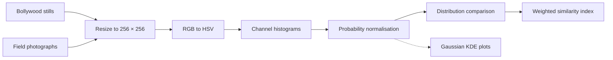

<div align="center">

# Bollywoodisation of North Indian Weddings

### A statistical study of cinematic and real-world wedding colour palettes

**Digital Image Processing** · **HSV Colour Analysis** · **Circular Statistics** · **Visual Culture**

*Can the colour aesthetics of Bollywood wedding scenes be identified in photographs from actual North Indian weddings?*

[Methodology](#methodology) · [Results](#results) · [Interpretation](#interpreting-the-results) · [Repository](#repository-and-usage)

</div>

---

## Overview

The visual language of North Indian weddings is often associated with Bollywood: vivid reds, warm lighting, saturated outfits, and elaborate staging. This project investigates that connection **quantitatively**, comparing the colour distributions of Bollywood wedding stills with photographs captured at real wedding venues.

A digital image-processing pipeline was applied to **250+ images** spanning the two datasets, including images of varied resolutions, colour profiles, sizes, and formats. Instead of comparing individual images pixel by pixel, the pipeline measures how closely their **aggregate hue, saturation, and value (HSV) distributions** align.

### Headline result


The two collections achieved a **weighted colour-similarity index of 0.8733 / 1.0 (87.33%)**. This indicates substantial agreement under the study's selected metrics and weighting scheme; it is **not** a claim that 87.33% of individual pixels match.

## Research approach

The analysis compares two image collections:

| Dataset | Description |
| :-- | :-- |
| **Bollywood** | Stills from Bollywood films depicting relevant wedding scenes. |
| **Field** | Photographs collected from real North Indian wedding venues, including settings in Chandigarh. |

The central research question is whether cinematic wedding colour choices are reflected in on-field celebrations, even when lighting, cameras, guest attire, and post-production conditions differ.

## Methodology

The image-processing pipeline converts visual material into comparable probability distributions.



1. **Standardise image size.** Every image is resized to **256 × 256 pixels** using OpenCV's area interpolation to reduce differences caused by input resolution.
2. **Convert RGB to HSV.** Hue represents colour family; saturation measures colour intensity; value represents brightness. Separating the channels helps distinguish palette choices from lighting differences.
3. **Extract histograms.** The methodology uses **256 bins for each RGB channel** and **36 hue bins (10° each)** for the HSV-based comparison. Histograms summarise which colours occur and their relative frequencies, without retaining pixel positions.
4. **Normalise distributions.** Histogram counts are scaled to sum to 1, yielding probability mass functions suitable for comparison across images.
5. **Estimate continuous density.** Gaussian **kernel density estimation (KDE)** smooths the distributions for visual interpretation.
6. **Compare colour channels.** Circular cosine similarity and circular Wasserstein/earth mover's distance (EMD) assess hue; cosine similarity and Jensen–Shannon divergence (JSD) assess saturation and value.
7. **Aggregate the index.** Channel scores are combined with a deliberate emphasis on hue, reflecting the study's focus on cultural colour choices.

For mathematical definitions and implementation excerpts, see the **[methodology appendix](docs/methodology_appendix.pdf)**.

## Results

| Dimension | Measure | Result |
| :-- | :-- | --: |
| **Overall** | **Weighted HSV similarity index** | **0.8733 (87.33%)** |
| Hue | Circular cosine similarity | **0.9240** |
| Hue | Normalised circular EMD *(distance; lower is closer)* | 0.2373 |
| Saturation | Cosine similarity | 0.7140 |
| Saturation | Jensen–Shannon divergence *(lower is closer)* | 0.2795 |
| **Saturation** | **Combined channel similarity** | **0.7172 (71.72%)** |
| Value | Cosine similarity | 0.9044 |
| Value | Jensen–Shannon divergence *(lower is closer)* | 0.1504 |
| **Value** | **Combined channel similarity** | **0.8770 (87.70%)** |

### Hue distribution: Bollywood vs field


*Hue KDE with wrap-around at 0°/360°. Both datasets have substantial density in the red region; the field distribution also exhibits a prominent feature around 240°.*

| Dominant-hue statistic | Bollywood | Field |
| :-- | --: | --: |
| Mean direction | **16.4°** | **344.4°** |
| Circular concentration, **R** | **0.628** | **0.287** |

The dominant directions are **32° apart along the shortest circular arc**. Both fall close to the red boundary of the hue wheel, despite appearing on opposite ends of a linear 0°–360° axis.

## Interpreting the results

**Hue — the strongest alignment.** The **0.9240 circular cosine score** shows that both datasets lean toward similar colour families, especially reds and adjacent warm tones. Bollywood's higher concentration (**R = 0.628**) suggests a more focused dominant-hue direction, while the lower field concentration (**R = 0.287**) indicates greater hue diversity. The field KDE peak around **240°** is consistent with an additional blue/violet component in real-venue imagery.

**Saturation — the largest difference.** The combined saturation score (**0.7172**) is weaker than the hue and value scores. Differences in camera equipment, venue lighting, colour grading, clothing, and ambient conditions are plausible contributors, but this analysis does not isolate their individual effects.

**Value — similar overall brightness distributions.** A **0.9044 cosine similarity** and **0.1504 JSD** yield a combined value score of **0.8770**. This suggests broadly similar distributions of light and dark across the two collections, despite differences in how the scenes were captured.

### How the overall score is calculated

The study gives the highest weight to hue, treating colour family as the most relevant signal for its research question:

```text
Hue similarity        = circular cosine similarity
Saturation similarity = 0.5 × saturation cosine + 0.5 × (1 − saturation JSD)
Value similarity      = 0.5 × value cosine      + 0.5 × (1 − value JSD)

Overall index         = 0.60 × hue similarity
                      + 0.20 × saturation similarity
                      + 0.20 × value similarity
```

The **circular EMD is reported as an additional hue-distance diagnostic**; it is not directly included in the weighted score. The displayed results are rounded, so recomputing the overall index from the displayed values may differ slightly in the last decimal place.

## Conclusion

The colour distributions of Bollywood wedding imagery and real North Indian wedding photography are **strongly aligned under this pipeline**, particularly in hue. Both datasets emphasise red-adjacent colour families, while field photographs display more variety in colour intensity and hue concentration.

These results **support the visual-aesthetic aspect of the “Bollywoodisation” hypothesis**: cinematic and real-world wedding imagery share a recognisable palette. The index alone does not establish that Bollywood *caused* those choices, nor does it prove statistical significance. Establishing cultural influence would require additional ethnographic, historical, or controlled comparative evidence.

## Scope and limitations

- The analysis compares **aggregate colour distributions**, not scene composition, rituals, decor placement, or the semantic meaning of individual objects.
- Camera settings, post-production, venue lighting, and sampling choices can affect HSV distributions.
- The **0–1 similarity index is a study-defined weighted metric**, not a calibrated probability or a percentage of identical pixels.
- No confidence intervals, significance tests, or causal identification are reported with the supplied results.
- The use of **60% weight for hue** encodes a research decision: colour family is prioritised over saturation and brightness.

## Repository and usage

The public repository currently contains the following top-level directories:

```text
DIP-Statistical-Analysis/
├── api/
├── results/
├── src/
├── transcription_model/
├── assets/                         # README figures (provided in this bundle)
├── docs/                           # Methodology PDF (provided in this bundle)
└── README.md
```

To obtain the project:

```bash
git clone https://github.com/parv-sr/DIP-Statistical-Analysis.git
cd DIP-Statistical-Analysis
```

The documented processing approach uses **Python, OpenCV, NumPy, and SciPy**. Consult the code in `src/` and the relevant modules for their required inputs and dependencies. A verified single-command entry point and dependency installation procedure were not available in the supplied documentation, so neither is assumed here.

## Further reading

- [Methodology appendix](docs/methodology_appendix.pdf) — preprocessing, histogram construction, KDE, circular statistics, JSD, and the weighted scoring function.
- [Source repository](https://github.com/parv-sr/DIP-Statistical-Analysis) — implementation and existing results.

---

<div align="center">

*An interdisciplinary application of digital image processing to visual culture and North Indian wedding aesthetics.*

</div>
